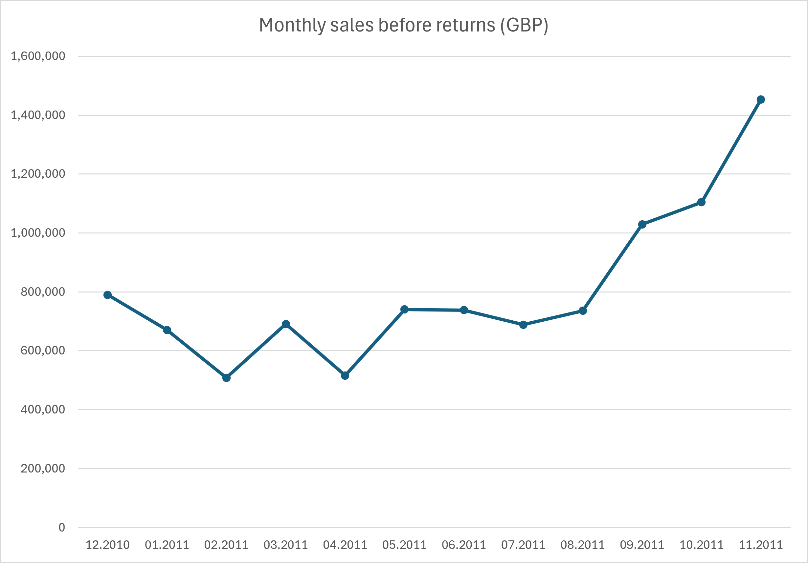
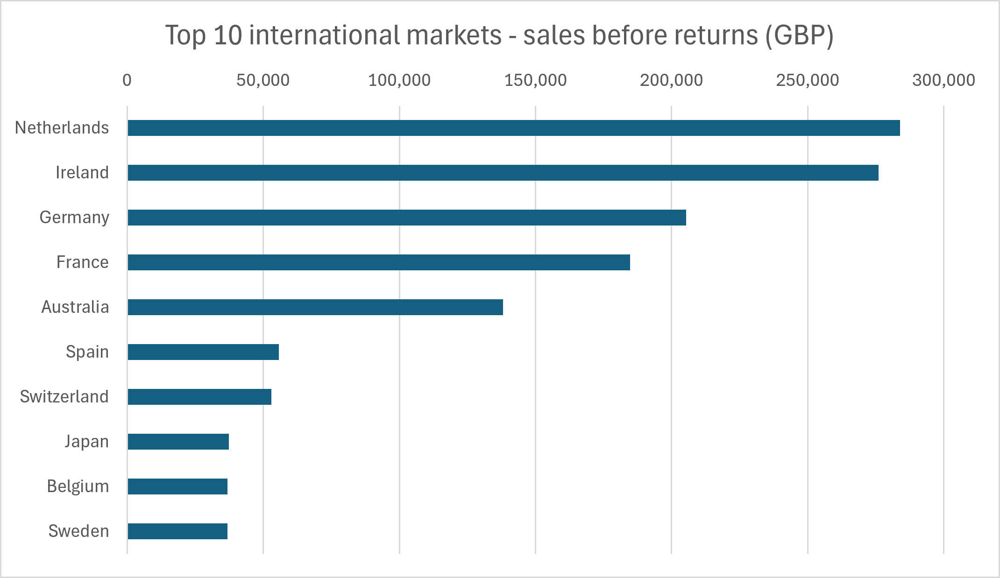

# Online Retail Sales Analysis

A first data-analysis portfolio project using **SQL (SQLite), Python and Excel** to explore real transaction data from a UK online gift retailer.

The analysis answers three questions: which products generated the most sales value, how sales changed by month, and which markets outside the UK contributed most. The focus is transparent data decisions and reproducible results.

## Key findings

- **REGENCY CAKESTAND 3 TIER (22423)** ranked first among product codes under the documented filters, with **£174,156.54** in positive sales before returns.
- **November 2011** was the highest of the 12 complete months analysed, at **£1,453,295.98**; February was lowest at **£508,081.54**. Sales increased each month from August through November. The data does not establish why.
- **Netherlands (£283,889.34)**, **Ireland (£276,090.36)** and **Germany (£205,381.15)** were the leading markets outside the UK over the full available period.
- Keeping one copy of identical records lowered filtered sales value by **£24,213.74 (about 0.235%)**. This is a sensitivity check, not proof that the repeated entries were erroneous.

## Monthly sales



December 2011 is excluded from this chart because the dataset ends on 9 December. Product and country rankings use the full available period, so their totals should not be compared directly with the sum of the monthly chart.

## International markets



Country represents customer residence, not necessarily shipping destination. The chart displays the source label `EIRE` as **Ireland**; the exported CSV preserves `EIRE`.

## Top products

Full available period: 1 December 2010 to 9 December 2011. Values are in GBP before returns.

| Rank | Stock code | Product label | Sales value |
|---:|---|---|---:|
| 1 | 22423 | REGENCY CAKESTAND 3 TIER | £174,156.54 |
| 2 | 23843 | PAPER CRAFT , LITTLE BIRDIE | £168,469.60 |
| 3 | 85123A | WHITE HANGING HEART T-LIGHT HOLDER | £104,462.75 |
| 4 | 47566 | PARTY BUNTING | £99,445.23 |
| 5 | 85099B | JUMBO BAG RED RETROSPOT | £94,159.81 |
| 6 | 23166 | MEDIUM CERAMIC TOP STORAGE JAR | £81,700.92 |
| 7 | 23084 | RABBIT NIGHT LIGHT | £66,870.03 |
| 8 | 22086 | PAPER CHAIN KIT 50'S CHRISTMAS | £64,875.59 |
| 9 | 84879 | ASSORTED COLOUR BIRD ORNAMENT | £58,927.62 |
| 10 | 79321 | CHILLI LIGHTS | £54,096.36 |

Totals are grouped by stock code. Each label is the most frequent nonblank, trimmed description on eligible unique invoice lines, with an alphabetical tie-breaker. Labels are descriptive, not an authoritative product catalogue; they do not change the calculated totals.

## Data and scope

Source: [UCI Online Retail](https://archive.ics.uci.edu/dataset/352/online+retail), **541,909 invoice lines**, eight columns, covering **1 December 2010 08:26 to 9 December 2011 12:50**. One row is one product line on an invoice, not one whole order.

Columns: `InvoiceNo`, `StockCode`, `Description`, `Quantity`, `InvoiceDate`, `UnitPrice`, `CustomerID`, and `Country`. Unit prices are in GBP. The workbook contains missing descriptions and customer IDs, so quality decisions are based on the file, not solely on catalogue metadata. Missing customer IDs are retained because these analyses do not require identifying individual customers.

## Method and decisions

1. Import the original Excel workbook into `sales_raw` without cleaning away records.
2. Inspect codes and descriptions. `DOT` and `POST` refer to postage; `M` is labelled Manual. Exclude these three codes from this analysis. This is not an exhaustive classification of every adjustment code.
3. Select positive quantities and prices and exclude invoice numbers beginning with `C`, which indicate cancellations.
4. Compare all records with fully unique records across the eight original columns. There are **536,641 unique records**, leaving **5,268 extra copies**. Use unique records for main outputs, while preserving the original data and the sensitivity comparison.
5. Calculate `SUM(Quantity * UnitPrice)`, group by product, month or country, and round final totals to two decimal places. Rank by the unrounded totals.
6. Export CSVs and create two charts in Excel. The SQL exploration records the evidence and reasoning behind the decisions.

For product 22423, entries described as faulty/damages have negative quantities and zero prices. They fail the existing sales filters; no additional description-based deletion is required.

## Reproduce the results

Requires Python 3.10+ and SQLite 3.25+ (normally bundled with modern Python). No database server or Node.js is needed for the command-line workflow.

1. Download and extract **Online Retail.xlsx** from [UCI](https://archive.ics.uci.edu/dataset/352/online+retail). Put the workbook in the repository root. The raw workbook and generated database are intentionally not committed.
2. From the repository folder, run:

```powershell
python -m venv .venv
.venv\Scripts\python.exe -m pip install -r requirements.txt
.venv\Scripts\python.exe import_data.py
.venv\Scripts\python.exe export_results.py
```

The importer replaces `sales_raw` on re-run. The exporter opens the database read-only and regenerates all three CSVs. On macOS/Linux, use `python3` to create the environment and `.venv/bin/python` for subsequent commands.

Alternatively, open `retail.db` in a SQLite client such as VS Code with SQLTools and run a final query from `sql/`. Run each complete statement, including its `WITH` block. `sql/exploration.sql` is the chronological learning and investigation record; use the three dedicated final query files for publishing results.

### Excel charts

`results/sales_charts.xlsx` contains the manually created charts and their source tables. PNGs in `charts/` are the images used above. These are static exports: if the data or filters change, regenerate the CSVs, update the workbook tables, and re-export the images. Month labels are displayed as `mm.yyyy`. The product-name column is added by the final SQL export and is not part of the original workbook chart tables.

## Files

```text
import_data.py             Import the original workbook into SQLite
export_results.py          Regenerate result CSVs from the final SQL
requirements.txt          Python dependencies
sql/exploration.sql        Documented investigation and earlier comparisons
sql/overview.sql           Row count and date range
sql/top_10_products.sql    Final product ranking and display labels
sql/monthly_sales.sql      Complete-month sales totals
sql/top_10_countries.sql   International market ranking
results/                   Three CSVs and the Excel chart workbook
charts/                    Two chart PNGs used in this README
```

## Limitations and next questions

- These are **positive sales before returns**, not net revenue, recognised accounting revenue or profit. Returns are excluded rather than deducted, and product costs are unavailable.
- Identical records may be legitimate repeated lines. Deduplication is an explicit analytical assumption, with the all-records comparison retained.
- This is one retailer and roughly one year of historical data. A late-year rise does not establish seasonality or predict future sales.
- Some codes and adjustments may remain beyond the three investigated exclusions. Product names are selected labels and can vary in the source.
- SQLite stores imported prices as floating-point values. Totals are rounded for reporting; this is an exploratory project, not an accounting ledger.
- Market totals do not reveal customer counts, margins or order concentration. Before recommending expansion, investigate whether a few wholesale customers drive the totals and assess costs and returns.

Useful follow-up: review stock availability for the leading products before the late-year period, and investigate customer concentration in the leading international markets. These are questions for further analysis, not proven causal recommendations.

## Source credit and project context

Chen, D. (2015). *Online Retail* [Dataset]. UCI Machine Learning Repository. [DOI: 10.24432/C5BW33](https://doi.org/10.24432/C5BW33). Dataset licensed under [CC BY 4.0](https://creativecommons.org/licenses/by/4.0/). This project transforms and summarises the dataset; charts and labels reflect the documented decisions above.

Built as a guided learning project with AI assistance for explanations, code and documentation. SQL exploration and Excel charts were developed step by step; final outputs were rerun against the local database and reconciled to the exported results.
